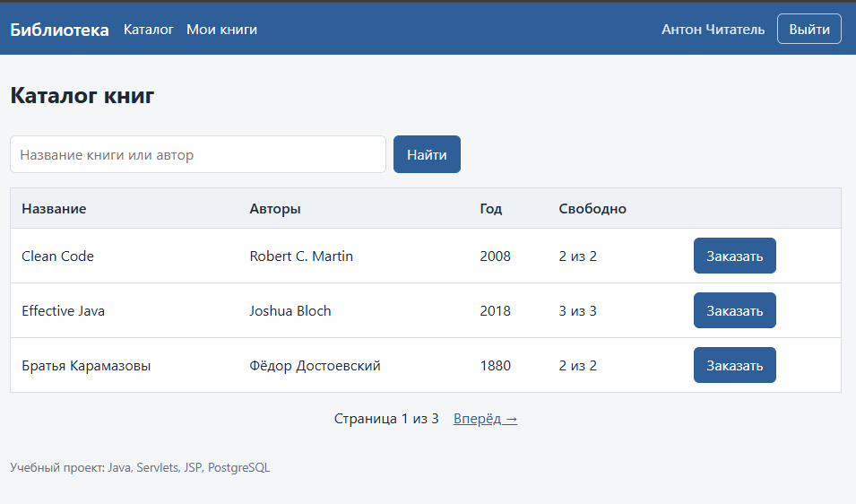
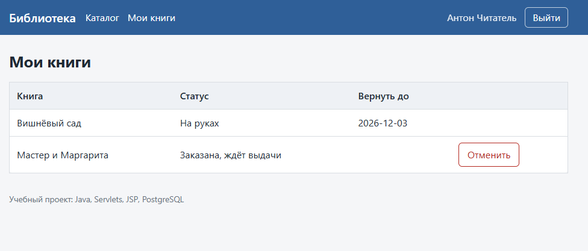
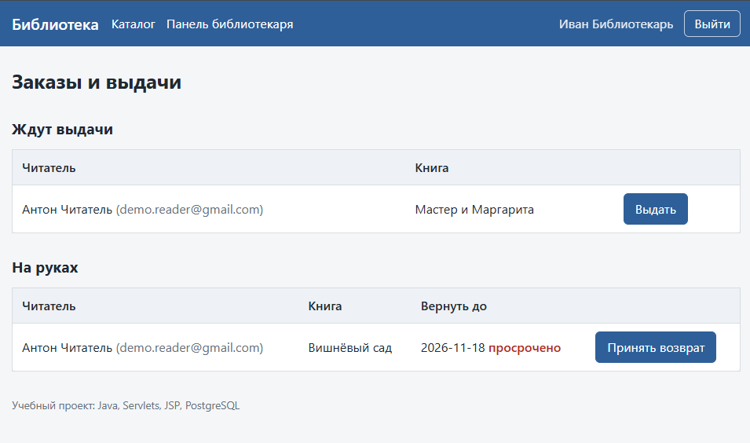
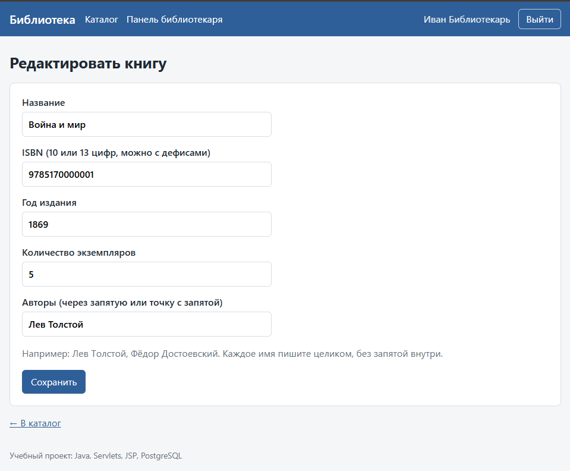
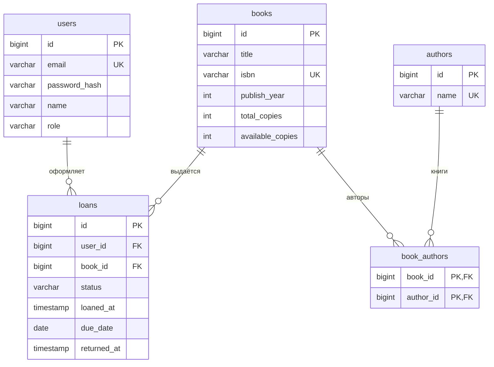
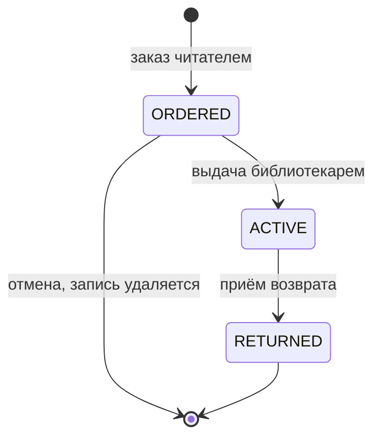

# Библиотека

Веб-приложение для учёта книг и их выдачи читателям. Читатель ищет книги в каталоге и заказывает их, библиотекарь управляет каталогом, выдаёт книги и принимает возврат.

Учебный проект на Servlets, JSP и JDBC, без Spring и ORM: цель была разобраться, как устроено веб-приложение на Java «под капотом».

**Демо:** https://library-qh6u.onrender.com

> Приложение размещено на бесплатном тарифе Render. После простоя сервис «засыпает», и первое открытие страницы может занять около минуты: просыпаются приложение и база данных.

## Возможности

**Для всех**
- Каталог книг с поиском по названию или автору и постраничным просмотром
- Регистрация и вход, пароли хранятся в виде хеша BCrypt

**Читатель**
- Заказ книги: экземпляр резервируется сразу
- Страница «Мои книги» со статусами заказов и сроками возврата
- Отмена заказа, пока книга не выдана
- Не более 3 открытых заказов и выдач одновременно, одну книгу нельзя заказать дважды

**Библиотекарь**
- Добавление, редактирование и удаление книг, у каждой книги может быть несколько авторов
- Выдача заказанных книг (срок возврата 14 дней) и приём возврата
- Список книг на руках с пометкой о просрочке
- Защита данных: нельзя удалить книгу, по которой есть выдачи, и нельзя указать экземпляров меньше, чем сейчас на руках

## Скриншоты

### Каталог

Поиск по названию и автору, постраничный просмотр, кнопка заказа у читателя.



### Мои книги

Заказ ждёт выдачи и его можно отменить, выданная книга показывает срок возврата.



### Заказы и выдачи (библиотекарь)

Выдача заказанных книг и приём возврата, просроченные выдачи подсвечены.



### Редактирование книги

Форма с проверкой данных на сервере, авторы вводятся через запятую.



## Что интересного внутри

- **Транзакции.** Заказ, отмена, возврат и сохранение книги вместе с авторами меняют несколько таблиц и выполняются атомарно: либо всё, либо ничего.
- **Параллельные запросы.** Последний экземпляр не достанется двум читателям: резервирование выполняется одним условным `UPDATE`. Лимит заказов защищён блокировкой строки пользователя, а повторный заказ одной книги закрыт частичным уникальным индексом в базе.
- **Авторы без проблемы N+1.** Авторы всех книг страницы каталога загружаются одним запросом.
- **Права доступа.** Фильтры отделяют страницы для вошедших пользователей и страницы библиотекаря, роль хранится в сессии на сервере.
- **Безопасность форм и вывода.** Весь пользовательский текст на страницах экранируется, после отправки формы выполняется перенаправление (Post-Redirect-Get), опасные действия доступны только через POST.
- **Обработка ошибок и логи.** Свои страницы 403, 404, 405, 500, логирование ключевых событий без паролей и адресов почты.
- **Тесты.** Бизнес-логика, фильтры и сервлеты проверяются unit-тестами с Mockito, работа с базой интеграционными тестами на PostgreSQL, включая сценарии с параллельными запросами.

## Технологии

| Область | Что используется |
|---|---|
| Язык и сборка | Java 21, Maven |
| Веб | Jakarta Servlet 6, JSP, JSTL, фильтры |
| База данных | PostgreSQL (Neon), JDBC, пул соединений HikariCP |
| Безопасность | BCrypt |
| Логирование | SLF4J, Logback |
| Тесты | JUnit 5, Mockito |
| Развёртывание | Docker, Tomcat 10.1, Render |


## Структура проекта

```
src/main
├── java/com/gvozd/library
│   ├── controller   сервлеты: принимают запрос, вызывают сервис, выбирают страницу
│   ├── service      бизнес-логика и проверка данных
│   ├── dao          интерфейсы доступа к данным
│   │   └── impl     реализации на JDBC
│   ├── model        сущности и объекты для вывода на страницы
│   ├── filter       кодировка, проверка входа, проверка роли
│   ├── exception    ожидаемые ошибки: ввод, вход, «не найдено»
│   └── util         пул соединений, хеширование паролей, flash-сообщения
├── resources        schema.sql, data.sql, logback.xml
└── webapp
    ├── static       стили
    └── WEB-INF      web.xml, JSP-страницы и общая шапка/подвал
```

Запрос проходит слои строго по порядку: **сервлет → сервис → DAO → база данных**. Сервлеты не работают с базой напрямую, а вся бизнес-логика находится в сервисах. Сервисы зависят от интерфейсов DAO, поэтому в тестах базу легко заменить заглушкой.

## База данных



Жизненный цикл выдачи (поле `loans.status`):



Что заложено в схему:

- **Роль** пользователя либо `READER`, либо `LIBRARIAN`, это проверяет `CHECK`. Через регистрацию можно стать только читателем.
- **Количество экземпляров.** `available_copies` хранится в таблице и меняется при заказе, отмене и возврате. Ограничения `CHECK` не дают ему стать отрицательным или больше `total_copies`.
- **Одна открытая выдача на пару «читатель и книга».** Это частичный уникальный индекс по `loans(user_id, book_id)` для статусов `ORDERED` и `ACTIVE`. Он не мешает взять ту же книгу снова после возврата.
- **Авторы.** Связь «многие ко многим» через `book_authors`. Уникальный индекс по `LOWER(name)` не позволяет завести двух авторов, которые отличаются только регистром.
- **История выдач.** У `loans` нет каскадного удаления, поэтому книгу, по которой есть выдачи, удалить нельзя. Связи книги с авторами при удалении книги удаляются каскадно.
- **Индексы** есть на `LOWER(books.title)`, `loans(user_id)`, `loans(book_id)` и `book_authors(author_id)`.

Скрипт создания таблиц лежит в `src/main/resources/schema.sql`.


## Запуск у себя

### Что понадобится

- JDK 21 или новее
- Maven 3.9 или новее
- PostgreSQL 12 или новее: локальный или облачный (например, Neon)

### 1. База данных

Создайте пустую базу и выполните скрипты по порядку:

1. `src/main/resources/schema.sql` создаёт таблицы и индексы, его можно запускать повторно;
2. `src/main/resources/data.sql` добавляет несколько тестовых книг, запускать нужно один раз.

### 2. Переменные окружения

| Переменная | Значение |
|---|---|
| `DB_URL` | JDBC-адрес, например `jdbc:postgresql://localhost:5432/library`. Для облачной базы добавьте `?sslmode=require` |
| `DB_USER` | имя пользователя базы |
| `DB_PASSWORD` | пароль |

PowerShell:

```powershell
$env:DB_URL="jdbc:postgresql://localhost:5432/library"
$env:DB_USER="postgres"
$env:DB_PASSWORD="пароль"
```

Linux и macOS:

```bash
export DB_URL="jdbc:postgresql://localhost:5432/library"
export DB_USER="postgres"
export DB_PASSWORD="пароль"
```

Пароль не хранится в коде: приложение читает его только из переменных окружения.

### 3. Запуск

```
mvn org.eclipse.jetty.ee10:jetty-ee10-maven-plugin:12.0.16:run
```

Приложение откроется по адресу http://localhost:8080.

### 4. Первый библиотекарь

Через регистрацию создаются только читатели. Зарегистрируйтесь на сайте и повысьте свою учётную запись в базе:

```sql
UPDATE users SET role = 'LIBRARIAN' WHERE email = 'ваш@email';
```

Затем выйдите и войдите заново: роль хранится в сессии и обновляется при входе.

## Тесты

```
mvn test
```

- **Unit-тесты** (сервисы, фильтры, сервлеты) работают без базы данных, зависимости заменены заглушками Mockito.
- **Интеграционные тесты** (DAO) работают с реальной базой из переменных окружения. Если переменные не заданы, эти тесты пропускаются. Они создают тестовые записи и в основном удаляют их после прогона, поэтому запускайте их на отдельной тестовой базе, а не на рабочей.

## Развёртывание

В репозитории есть `Dockerfile` из двух этапов: сборка WAR-файла образом с Maven и запуск на Tomcat 10.1 отдельным образом. Приложение разворачивается как `ROOT.war`, поэтому открывается по корню сайта. Память JVM ограничена параметрами в `CATALINA_OPTS`, чтобы приложение помещалось в небольшой контейнер на 512 МБ.

Развёртывание на Render:

1. **New → Web Service**, выберите репозиторий, язык **Docker**, ветку `main`, тариф Free.
2. Задайте переменные окружения `DB_URL`, `DB_USER`, `DB_PASSWORD` и `PORT=8080`.
3. После этого каждое слияние в `main` автоматически запускает новую сборку.

Особенности, на которые пришлось обратить внимание при развёртывании:

- Бесплатная база и бесплатный сервис «засыпают» после простоя. Пул соединений создаётся без проверки подключения и при первом запросе ждёт просыпающуюся базу до 30 секунд.
- Класс драйвера PostgreSQL указан в настройках пула явно. Tomcat хранит библиотеки приложения в отдельном загрузчике классов, и без этого драйвер не находится.